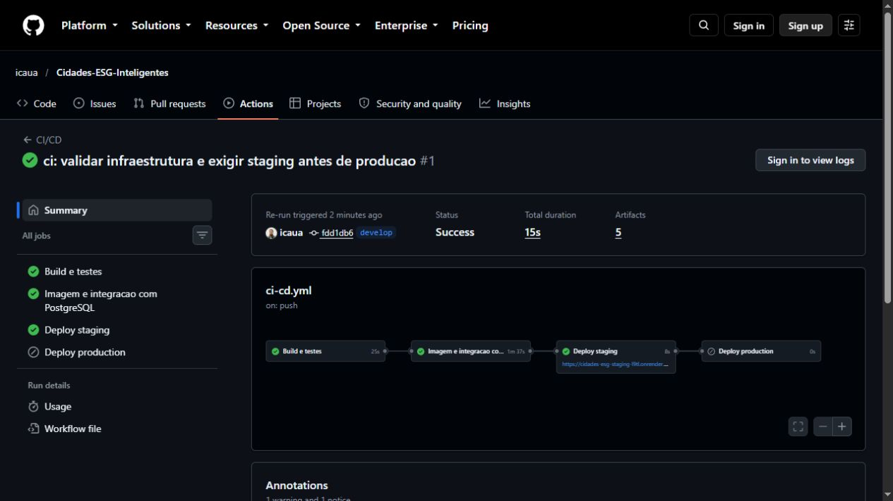
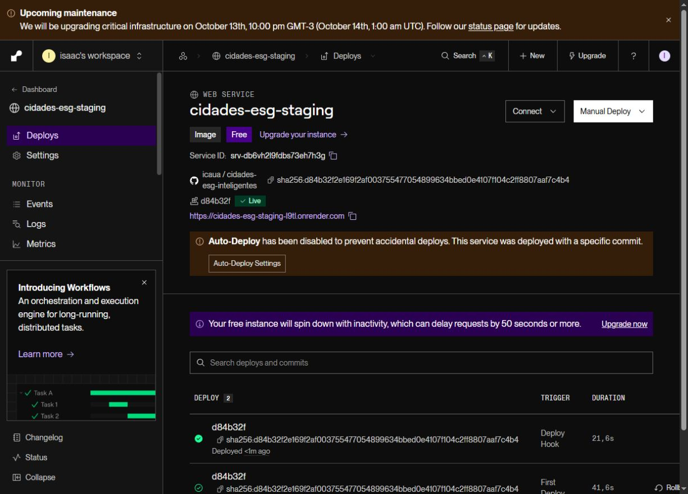

# Projeto - Cidades ESG Inteligentes

**Integrante:** Isaac Cauã Mourão da Silva - **RM 564071**  
**Repositório:** https://github.com/icaua/Cidades-ESG-Inteligentes

**Atividade:** Navegando pelo mundo DevOps  
**Atualização:** 13/10/2026

API acadêmica em C# para cadastrar cidades, calcular uma pontuação ESG e consultar um ranking.
Os indicadores e dados iniciais são fictícios, usados apenas para demonstração.
Swagger é a interface de demonstração, disponível na raiz da aplicação.

> **Situação da entrega:** build, 26 testes xUnit, 9 testes Python, Docker Compose,
> GHCR e deploy automatizado em staging comprovados. Produção permanece pendente:
> o Render recusou um segundo PostgreSQL gratuito, e o titular optou por manter custo zero.
> O ZIP é uma revisão com pendência, não uma entrega integralmente aprovada.

## Estrutura

~~~text
CidadesESGInteligentes/
  Dockerfile
  docker-compose.yml
  .env.example
  .env.staging.example
  .env.production.example
  .github/workflows/ci-cd.yml
  CidadesESGInteligentes.sln
  src/CidadesESGInteligentes.Api/
  tests/CidadesESGInteligentes.Tests/
  scripts/
  docs/evidencias/
  README.md
~~~

O ZIP também inclui `docs/Documentacao-tecnica.pdf`.
A aplicação usa PostgreSQL; o schema e os registros fictícios são criados no primeiro início.

## Como executar localmente com Docker

Pré-requisitos: Docker Engine ou Docker Desktop com containers Linux e plugin Compose v2 com suporte a `--wait`.
Execute na pasta extraída do projeto:

~~~powershell
Copy-Item .env.example .env
# Edite .env e substitua DB_PASSWORD antes de continuar.
docker compose config --quiet
docker compose up -d --build --wait --wait-timeout 180
docker compose ps
curl.exe --fail http://localhost:8080/health
curl.exe --fail http://localhost:8080/api/cidades/ranking
~~~

No Linux/macOS, use `cp .env.example .env` e `curl` em vez de `curl.exe`.
Abra [Swagger local](http://localhost:8080/). O health deve indicar `status=ok`,
`ambiente=Production` e `versao=local` no cenário padrão.

~~~powershell
docker compose logs --tail 100 api
docker compose logs --tail 100 db
docker compose down
~~~

`down` preserva o volume. `down -v` apaga o banco local e deve ser usado apenas
quando quiser descartar os dados. Alterar a senha no arquivo .env não muda a senha
de um PostgreSQL já inicializado; use a senha original ou altere-a no banco.

### Staging e produção simultâneos na mesma máquina

~~~powershell
Copy-Item .env.staging.example .env.staging
Copy-Item .env.production.example .env.production
# Defina senhas diferentes nos dois arquivos.
docker compose --env-file .env.staging -p cidades-staging up -d --build --wait --wait-timeout 180
docker compose --env-file .env.production -p cidades-production up -d --build --wait --wait-timeout 180
curl.exe --fail http://localhost:8081/health
curl.exe --fail http://localhost:8082/health
~~~

Os projetos Compose isolam containers, redes e volumes. Staging usa a porta 8081,
produção usa 8082. O banco não publica porta no host: a API acessa `db:5432` na rede interna.
Esses comandos demonstram dois ambientes locais; não constituem evidência de deploy remoto.

### Executar os testes fora do Docker

Com SDK .NET 8 e Python 3 instalados:

~~~powershell
dotnet restore
dotnet build --configuration Release --no-restore
dotnet test --configuration Release --no-build --logger "trx;LogFileName=resultado-testes.trx" --results-directory resultados-testes
python -m unittest discover -s scripts -p "test_*.py" -v
~~~

Os 26 casos xUnit cobrem cálculo, pesos, faixas, limites e validação do cadastro.
Não são testes de integração de controllers. O CI complementa essa cobertura subindo
API e PostgreSQL e consultando o ranking. Os 9 testes Python verificam o controle de
versão/ambiente e o comportamento de falha do smoke test; usam mocks e não comprovam deploy.

## Pipeline CI/CD

Ferramentas: GitHub Actions, Docker Buildx, GitHub Container Registry (GHCR) e Render.
Definição: [.github/workflows/ci-cd.yml](.github/workflows/ci-cd.yml).

| Evento | Build/testes | Imagem + integração | Deploy |
| --- | --- | --- | --- |
| Pull request para develop/main | Sim | Build local no runner, sem publicar | Não |
| Push em develop | Sim | Publicação no GHCR e teste com PostgreSQL | Staging |
| Push em main | Sim | Publicação no GHCR e teste com PostgreSQL | Staging e depois produção, mesma imagem |
| Execução manual em develop/main | Sim | Publicação e integração | Develop: staging; main: staging e depois produção |

1. **Build e testes:** restaura NuGet, compila Release e executa xUnit e testes do verificador.
   Os relatórios TRX são anexados à execução.
2. **Imagem e integração:** constrói o Dockerfile, embute `APP_VERSION=SHA`, gera
   `ghcr.io/owner/repositorio:SHA_COMPLETO`, e publica nos eventos elegíveis.
   Sobe a mesma imagem com PostgreSQL via Compose e verifica health e ranking.
   Uma imagem pode ser publicada antes do smoke test; se ele falhar, nenhum deploy é iniciado.
3. **Deploy:** somente após o job de integração terminar com sucesso, envia ao hook
   do Render a imagem com referência imutável `ghcr.io/owner/repositorio@sha256:...`.
   O serviço deve ser configurado no Render como **imagem existente de registry**.
4. **Verificação:** exige `status=ok`, ambiente esperado e SHA do commit atual,
   além de resposta JSON em `/api/cidades/ranking`. Uma versão antiga não aprova o deploy.
   Há até 40 tentativas, pausa de 10 segundos e timeout de 8 segundos por requisição.
5. **Evidência:** os jobs guardam TRX, logs e JSON como artifacts do GitHub Actions.

A concorrência dos deploys é serializada entre as duas branches. Em develop, o fluxo
termina em staging. Em main, primeiro implanta e verifica staging e só então promove
o mesmo digest para produção. O job de produção depende explicitamente do sucesso
de staging; falha ou configuração ausente impede a promoção. Não existe rollback automático.

O teste de integração também verifica rede compartilhada e volumes nomeados, grava
um marcador no PostgreSQL do projeto descartável `ci`, recria os containers sem
remover o volume e confirma a persistência do marcador. Nenhum banco Render é alterado
por esse teste. O marcador é removido após a verificação.

### Configuração inicial do GitHub e Render

1. Crie um repositório GitHub e envie os arquivos, incluindo a pasta oculta `.github`.
   Repositório informado: icaua/Cidades-ESG-Inteligentes; conexão GitHub com acesso de escrita validado.
2. Crie as branches `main` e `develop` e os GitHub Environments
   `production` e `staging`.
3. Execute o workflow para gerar a primeira imagem no GHCR. O primeiro deploy
   falhará enquanto hooks/URLs não estiverem configurados; isso não impede o job de imagem.
4. No Render, crie dois Web Services a partir de **Existing Image**, apontando para
   uma tag SHA já publicada do mesmo pacote GHCR. Para pacote privado, configure no
   Render uma credencial com permissão de leitura do pacote; para pacote público, ela é dispensável.
5. Crie dois bancos PostgreSQL separados e configure cada serviço conforme a tabela:

| Configuração Render | Staging | Produção |
| --- | --- | --- |
| ASPNETCORE_ENVIRONMENT | Staging | Production |
| ASPNETCORE_HTTP_PORTS | 8080 | 8080 |
| PORT | 8080 | 8080 |
| DATABASE_URL | URL do banco staging | URL do banco produção |
| Health check path | /health | /health |
| Imagem | mesmo pacote GHCR | mesmo pacote GHCR |

Não sobrescreva `APP_VERSION` no Render: ela é incorporada à imagem.
Para bancos externos que exigem TLS e validação de certificado, ajuste e valide
a política de conexão do provedor antes de usar dados reais. O parser de
`DATABASE_URL` atual usa `SslMode.Prefer` e não interpreta parâmetros da query da URL.

6. Copie o **Deploy Hook** de cada serviço para os Secrets do GitHub.
   Cadastre também as URLs públicas em Variables, conforme abaixo:

| Tipo | Nome | Uso |
| --- | --- | --- |
| Secret | RENDER_DEPLOY_HOOK_STAGING | Hook secreto do serviço staging |
| Secret | RENDER_DEPLOY_HOOK_PRODUCTION | Hook secreto do serviço produção |
| Variable | STAGING_URL | URL HTTPS pública de staging, sem /health |
| Variable | PRODUCTION_URL | URL HTTPS pública de produção, sem /health |

Os hooks podem ficar no repositório ou no Environment correspondente. As URLs devem ser Variables do repositório, para que a configuração dos dois ambientes possa ser verificada em conjunto.
`GITHUB_TOKEN` é fornecido automaticamente pelo Actions; o workflow solicita
`packages: write` apenas no job de imagem. Políticas da organização precisam permitir isso.

7. Execute novamente develop, registre staging e depois execute main e registre produção.
   Os serviços devem apontar para o mesmo nome de pacote passado no hook; apenas
   tag/digest podem variar. Não configure outra automação que faça deploy fora desse fluxo.
   Escolha os planos no provedor conforme os recursos disponíveis na sua conta.

### Rollback

No Render, faça rollback manual para um digest anterior validado do mesmo pacote
ou dispare o hook usando esse digest. Verifique o health contra o SHA anterior e
consulte o ranking. A mudança de imagem não restaura dados do banco; mantenha backup
antes de alterações de schema. Este projeto usa schema fixo com `EnsureCreated`,
sem migrações incrementais.

## Containerização

O Dockerfile tem dois estágios: SDK para restaurar/compilar e ASP.NET Runtime para
executar. Copiar os projetos antes dos fontes permite reaproveitar o cache do restore.
A imagem final roda com o usuário `app`, expõe 8080, inclui curl para o healthcheck
e recebe o SHA em `APP_VERSION`. O tamanho final depende do build e não foi medido.

~~~dockerfile
# =========================================================
# Estagio 1 - build: compila e publica a aplicacao.
# Usa a imagem do SDK, que e grande (~800 MB) e nao vai para producao.
# =========================================================
FROM mcr.microsoft.com/dotnet/sdk:8.0 AS build
WORKDIR /source

# Copiar primeiro apenas os arquivos de projeto permite que o Docker reaproveite
# o cache do restore enquanto nenhuma dependencia NuGet mudar.
COPY CidadesESGInteligentes.sln ./
COPY src/CidadesESGInteligentes.Api/CidadesESGInteligentes.Api.csproj src/CidadesESGInteligentes.Api/
COPY tests/CidadesESGInteligentes.Tests/CidadesESGInteligentes.Tests.csproj tests/CidadesESGInteligentes.Tests/
RUN dotnet restore

COPY . .
RUN dotnet publish src/CidadesESGInteligentes.Api/CidadesESGInteligentes.Api.csproj \
    --configuration Release \
    --no-restore \
    --output /app/publish

# =========================================================
# Estagio 2 - runtime: apenas o necessario para executar.
# A imagem final exclui o SDK e os arquivos de desenvolvimento.
# =========================================================
FROM mcr.microsoft.com/dotnet/aspnet:8.0 AS runtime
WORKDIR /app

# curl e usado pelo HEALTHCHECK abaixo; a imagem base nao traz nenhum cliente HTTP.
RUN apt-get update \
    && apt-get install -y --no-install-recommends curl \
    && rm -rf /var/lib/apt/lists/*

COPY --from=build /app/publish .

ENV ASPNETCORE_HTTP_PORTS=8080
ARG APP_VERSION=local
ENV APP_VERSION=$APP_VERSION
LABEL org.opencontainers.image.revision=$APP_VERSION
EXPOSE 8080

HEALTHCHECK --interval=30s --timeout=5s --start-period=40s --retries=3 \
    CMD curl -fsS http://localhost:8080/health || exit 1

# Usuario sem privilegios ja incluido nas imagens oficiais do .NET 8.
USER app

ENTRYPOINT ["dotnet", "CidadesESGInteligentes.Api.dll"]
~~~

Comandos de build e inspeção:

~~~powershell
docker build --build-arg APP_VERSION=local -t cidades-esg-api:local .
docker image inspect cidades-esg-api:local
docker compose up -d --no-build --wait --wait-timeout 180
~~~

Variáveis principais: `DB_HOST`, `DB_PORT`, `DB_NAME`, `DB_USER`, `DB_PASSWORD`,
`DATABASE_URL` (prioritária), `ASPNETCORE_ENVIRONMENT`, `API_PORT`, `API_IMAGE`
e `APP_VERSION`. No Compose, host/porta internos são `db` e `5432`.
Segredos reais não devem entrar no ZIP nem no Git.

## Prints do funcionamento

### Execução comprovada em 13/10/2026

- [GitHub Actions: run 38323935914, tentativa 2](https://github.com/icaua/Cidades-ESG-Inteligentes/actions/runs/38323935914) - sucesso em develop.
- Commit da aplicação: `fdd1db6f2313336c3355ba6cf7b06b7ba746d314`.
- Imagem: `ghcr.io/icaua/cidades-esg-inteligentes@sha256:d84b32f2e169f2af003755477054899634bbed0e4107f104c2ff8807aaf7c4b4`.
- [Staging](https://cidades-esg-staging-l9tl.onrender.com) · [Health](https://cidades-esg-staging-l9tl.onrender.com/health) · [Ranking](https://cidades-esg-staging-l9tl.onrender.com/api/cidades/ranking).
- [Deploy Render por hook](https://dashboard.render.com/web/srv-db6vh2l9fdbs73eh7h3g/deploys/dep-db6vibs9v7es739vje50) - live.

| Evidência | Resultado | Arquivo |
| --- | --- | --- |
| Build local .NET 8 | 0 erros, 0 avisos | [build.log](docs/evidencias/2026-10-12/build.log) |
| xUnit | 26 aprovados local e CI | [TRX](docs/evidencias/2026-10-12/testes/resultado-testes.trx) |
| Python | 9 aprovados | [python.log](docs/evidencias/2026-10-12/python.log) |
| Docker Compose | API e banco saudáveis, rede e volume, persistência após recriação | [ci-compose.json](docs/evidencias/2026-10-12/github-38323935914/integracao-docker/ci-compose.json) |
| Deploy automatizado staging | success=true; hook HTTP 200 e ID do deploy | [artifact atual](docs/evidencias/2026-10-12/github-38323935914/deploy-staging-11801636843/staging.json) |
| Endpoints após deploy live | Staging, SHA correto, ranking com 4 cidades | [staging-confirmado.json](docs/evidencias/2026-10-13/staging-confirmado.json) |
| Render | trigger=deploy_hook, status=live | [render-deploys.json](docs/evidencias/2026-10-13/render-deploys.json) |
| Produção | Não executada | [Pendências](docs/STATUS-ENTREGA.md) |

A tentativa 1 falhou por hook/URL ausentes. A tentativa 2 reexecutou staging após
a configuração e reaproveitou build/imagem aprovados. Produção foi ignorada por ser
develop; não há evidência de implantação em produção. Os registros de falha foram
preservados com IDs próprios. O Docker foi executado no runner Ubuntu, não no Windows local.
O navegador integrado bloqueou a abertura direta do endpoint; a validação HTTP real
foi realizada pelo script e salva em JSON. Não foi fabricada captura do endpoint.

O banco gratuito expira em **11/11/2026**, conforme o Render. Serviços gratuitos podem
hibernar. A configuração de produção está descrita em [CONFIGURACAO-RENDER.md](docs/CONFIGURACAO-RENDER.md).

## Tecnologias utilizadas

C#; .NET 8; ASP.NET Core Web API; Entity Framework Core 8; Npgsql; PostgreSQL 16;
Swagger/Swashbuckle; xUnit; Microsoft.NET.Test.Sdk; Docker; Docker Compose v2;
GitHub Actions; GHCR; Render; Python 3 (automação) e ReportLab (geração do PDF).

## Desafios encontrados e soluções

| Desafio | Solução implementada |
| --- | --- |
| Nomes globais impediam dois ambientes Compose | Removidos nomes fixos; isolamento por projeto com -p |
| Health antigo poderia aprovar um deploy novo | SHA embutido na imagem e verificado após o deploy |
| API poderia responder sem banco disponível | /health consulta conectividade e retorna 503 em falha |
| Deploy poderia buscar imagem diferente da validada | Hook recebe digest imutável do build |
| Faltava comprovação local | SDK temporário, build e execução dos testes com logs |
| Docker ausente no Windows | Build e Compose executados no runner Ubuntu do Actions |
| Hook/URL de staging ausentes | Secret e variável configurados; rerun concluído |
| Apenas um PostgreSQL gratuito no Render | Produção pendente por decisão de manter custo zero |

Limites do cenário acadêmico: Swagger e CRUD são públicos, sem autenticação;
schema fixo com `EnsureCreated`; uma instância por ambiente; sem rollback ou
backup automatizado. O exemplo não pretende operar dados sensíveis em produção real.

## Regerar documentação e pacote

~~~powershell
python -m pip install -r scripts/requirements-docs.txt
python scripts/generate_documentation.py
python scripts/package_project.py
~~~

A geração produz `output/pdf/Documentacao-tecnica.pdf` e
`output/CidadesESGInteligentes-revisao-pendente.zip` enquanto houver pendências.
O modo `python scripts/package_project.py --final` recusa gerar uma entrega
definitiva sem aprovação registrada. O ZIP antigo de 04/10 não representa esta revisão.
O relatório atual é `docs/evidencias/2026-10-13/validacao.json`.
As mudanças finais de documentação não alteram a revisão implantada. O empacotador
exclui bin, obj, ferramentas temporárias, .git e arquivos de segredos.

## Referências técnicas

- [Render: deploy hooks e parâmetro imgURL](https://render.com/docs/deploy-hooks)
- [Microsoft: SDK temporário com dotnet-install](https://learn.microsoft.com/en-us/dotnet/core/tools/dotnet-install-script)
- [GitHub Actions](https://docs.github.com/en/actions)
- [Docker Compose](https://docs.docker.com/compose/)

## Checklist de entrega (obrigatório)

**Preenchimento em 13/10/2026.** Itens com evidências incompletas continuam desmarcados.

| Item | OK | Situação |
| --- | :---: | --- |
| Projeto compactado em .ZIP com estrutura organizada | [x] | Pacote de revisão; inclui fontes, scripts, evidências e PDF |
| Dockerfile funcional | [x] | Imagem construída no CI e executada no Compose e Render |
| docker-compose.yml ou arquivos Kubernetes | [x] | Compose executado; rede, volume, persistência e healthchecks comprovados |
| Pipeline com etapas de build, teste e deploy | [ ] | Funcionou até staging; falta execução de produção |
| README.md com instruções e prints | [x] | Capturas reais do Actions e Render staging incluídas |
| Documentação técnica com evidências (PDF ou PPT) | [ ] | PDF atualizado; evidência de produção ainda ausente |
| Deploy realizado nos ambientes staging e produção | [ ] | Apenas staging comprovado |
